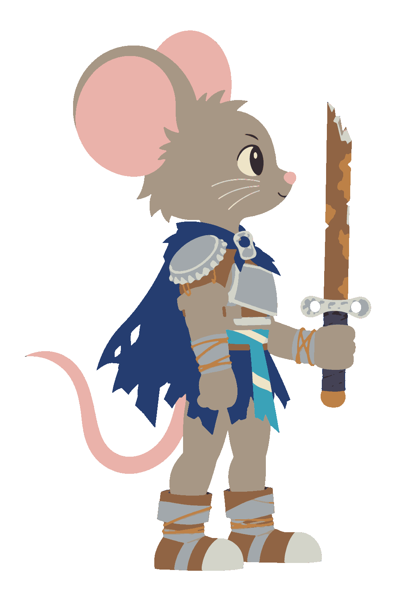
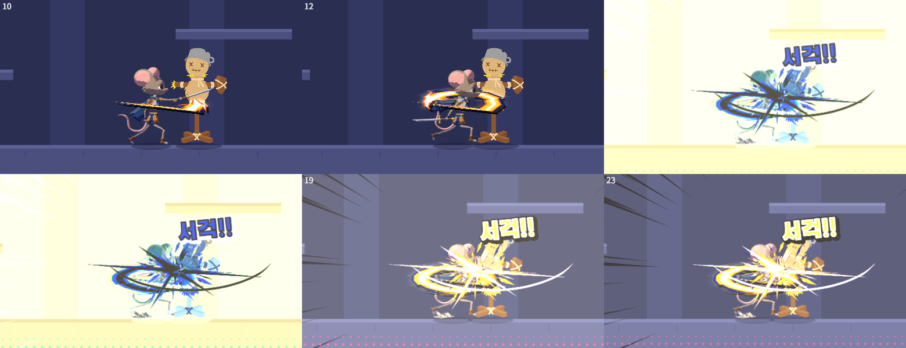

# 기사쥐 — 컨셉 기획서

| 항목 | 내용 |
|---|---|
| 작성자 | 정승운 |
| 작성일 | 2026-10-29 |
| 버전 | v0.6 |

# 목차
- 기획의도
- 원페이지 기획서
- 캐릭터
- 비쥬얼 가이드
- 액션 모션
- 이펙트 가이드
- 전투 시스템
- 스토리 · 월드
- 제작 파이프라인
- 미정 항목
- 변경 이력

## 기획의도
- 원작 게임의 파괴 이미지와 기사쥐의 우직한 낭만을 살린 2D 액션 메트로베니아 제작.
- 스토리 라인: 현대 인간 도시의 하수구에서 주운 물건으로 기사 장비를 만든 꼬마쥐가 전설의 명검을 찾아 떠나는 여정.
- 레퍼런스: 카타나 제로, 할로우 나이트, 할로우 나이트: 실크송.
- 원작 「찍!찍!!찍!!!」의 기사쥐 초필살기에서 보여준 시원한 베기 연출을 한 판 내내 손으로 느끼게 하는 것이 목표.
- 귀여운 겉모습과 날카로운 손맛의 대비. 보기엔 동글동글, 치면 묵직함.
- 그림체는 픽셀, 감성은 팝아트. 플랫하게 그린 원본을 코드로 도트화하고, 그 위에 만화식 연출을 얹는 방향.

## 원페이지 기획서
| 항목 | 내용 |
|---|---|
| 장르 | 2D 횡스크롤 액션 메트로베니아 (방 연결 + 능력 잠금) |
| 플랫폼 | PC (웹 프로토 → 유니티 본편) |
| 시점 | 옆모습 고정, 플레이어 가슴 높이 기준 카메라, 세로 따라가기 |
| 핵심 재미 | 몸을 감아 도는 베기의 손맛, 끊김 없는 이동·베기·대시·내려찍기 연결 |
| 주인공 | 도시의 꼬마 기사쥐. 병뚜껑 견갑과 파이프 검으로 시작 |
| 목표 | 뒷골목과 하수도, 버려진 지하철역을 지나 전설의 명검에 닿고, 스스로 꿈꾸던 기사가 되는 여정 |
| 성장 | 치즈 경험치로 레벨업 → 노드 포인트로 그물형 스킬 노드 습득. 탐험 아이템(이단 점프·체력 조각) |
| 차별점 | 플랫 그림 + 코드 셰이더 명암·망점·도트화, 칼 궤적을 따라 휘는 칼빛, 팝아트 데미지 숫자 |

- 한 줄 요약: 도시의 쓰레기로 기사 장비를 만든 꼬마쥐가 낭만을 좇아 명검을 찾아가는 픽셀 팝아트 액션 메트로베니아.

## 캐릭터
### 기사쥐 (견습 기사)
- 현대 인간 도시의 하수구와 뒷골목에서 살아가는 꼬마쥐. 원작 「찍!찍!!찍!!!」 기사쥐의 우직한 성격과 엑스칼리버 모티프를 잇는 주인공.
- 진짜 기사가 되고 싶지만 가진 것이 없어 주운 쓰레기로 갑옷과 검을 만들어 입은 상태. 보잘것없는 장비와 진지한 태도의 대비가 캐릭터 핵심.
- 투구 없이 큰 둥근 귀가 드러나는 실루엣. 성장 뒤에도 귀와 꼬리 실루엣 유지.
- 비율은 큰 머리와 짧고 단단한 팔다리의 약 2.2등신 치비. 현재 리그 비율 유지.
- 얼굴은 작고 단정하게. 눈은 작은 타원에 하이라이트 한 점, 짧은 수염.
- 시작 장비: 찌그러진 병뚜껑 견갑, 잘라 편 캔 조각 흉갑, 캔 따개 고리 걸쇠, 전선과 테이프 결속, 찢어진 남색 천 망토, 병 라벨 허리띠.
- 시작 무기: 납작하게 찌그러진 파이프 조각 검. 깨진 끝, 전기테이프 손잡이, 캔 따개 고리 가드 구성. 무기 피벗은 테이프 손잡이 중심, 정면·뒷모습에선 칼을 손보다 뒤에 그려 쥔 느낌 확보.
- 포인트 컬러는 남색 + 재활용 플라스틱의 시안·자홍. 칼빛의 흰·노랑·주황이 몸 위에서 읽히는 조합.
- 성장 방향: 주운 쓰레기 장비에서 시작해 점점 정교한 기사 장비로 업그레이드. 재료 등급·획득 순서·외형 단계는 미정.
- 리그 에셋: `art/knight/rig_urban/`(옆모습), `rig_front_urban/`(정면·뒷모습), `v7/spin/`(공중 회전 통그림). 이전 원안은 비교용으로만 보관.

### 적
| 이름 | 지역 | 행동 |
|---|---|---|
| 딱정벌레 | 뒷골목 | 바닥을 기다 가까이 오면 몸을 젖혔다 돌진. 돌진 중에만 몸통 공격 판정 |
| 날파리 | 뒷골목 | 공중에서 맴돌다 젖혔다 플레이어 쪽으로 급강하 후 제자리 복귀 |
| 바퀴벌레 | 지하철역 | 천장 배관에 거꾸로 매달렸다 바로 밑에 오면 낙하 덮침. 바닥에선 멈칫과 짧은 질주 반복, 질주 중 반대로 꺾는 속임수, 체력 절반 이하에서 도약 덮침 |
| 비둘기 | 지하철역 | 거리 유지. 깃털 3개 부채꼴 투척과 U자 훑기 급강하를 번갈아 사용 |

- 적은 방에 들어올 때마다 다시 생기고, 잡으면 치즈(경험치)를 떨어뜨림.

### 보스
- 개굴대왕: 하수도의 왕, 거대 두꺼비. 컷아웃 리그. 사양은 전투 시스템 항목.
- 레일 지네: 종착역의 주인, 거대 지네. 12마디 사슬 리그. 사양은 스토리 · 월드 항목.

### 허수아비 (테스트 대상)
- 모션 확인용 훈련 허수아비. 냄비 투구, 짚 몸통, 나무 방패. 시작 방(밤의 뒷골목)에 배치.
- 서 있음 / 맞고 기울어짐 / 허리가 잘린 위·아래 3장.

## 비쥬얼 가이드
- 그림체 = 픽셀, 감성 = 팝아트. 플랫한 원본을 생성하고 픽셀화는 코드로 처리. 픽셀아트를 직접 생성하지 않음.
- 칼 궤적 끝에 이펙트를 붙여 가로지르는 베기를 크게 움직이는 모션과 함께 연출, 타격감 강조.
- 리깅을 통해 캐릭터의 사실적 액션 표현. 리깅으로 힘든 자세(공중 회전, 사망 등)는 통그림 프레임 병행.
- 그림은 명암 없는 완전 플랫 원본으로 생성. 외곽선 없음, 영역마다 단색 하나.
- 명암은 코드 셰이더로 얹음.
  - 부위 실루엣으로 쿠션 모양의 높이를 만들고, 그 기울기로 법선을 계산하는 방식.
  - 빛은 화면 왼쪽 위 앞. 밝기를 2단으로 끊어 그림자 1톤 + 하이라이트 1톤의 셀 셰이딩.
  - 그림자는 남보라 곱하기, 하이라이트는 따뜻한 흰색. 원작 NKK의 1톤 그림자 + 1톤 하이라이트 느낌 계승.
  - 부위가 회전해도 빛 방향이 유지되도록 빛 각도별(24방향) 명암을 미리 구워 두고 그릴 때 고르는 구조.
- 보스도 배경과 같은 굵기로 도트화. 부위를 미리 줄여 명암·망점을 구운 뒤, 보스 전용 판(도트 4px)에서 한꺼번에 픽셀화해 돌아가는 부위도 같은 격자로 끊김.
- 배경 원본도 동일한 무명암 플랫 규칙 적용. 레이어별 흐림, 안개, 명암, 픽셀화는 코드 후처리.

### 배경의 깊이 구조
- 바닥 가까이에 소품을 여러 줄 놓는 방식이 아니라, 화면 전체 높이를 쓰는 세트 판을 여러 깊이로 세워 겹치는 구조.
- 방마다 테마(도시 · 하수도 · 지하철)를 지정하고 테마별 레이어 묶음 사용.
- 도시 레이어 순서와 카메라 시차: 밤하늘(0.02) → 스카이라인(0.11) → 원경 고층 건물(0.28) → 중경 벽·비상계단(0.5) → 깊이 3단 소품(0.62 / 0.78 / 0.92) → 플레이 바닥(1) → 높이형 전경(1.12) → 바닥 전경(1.18).
- 각 판은 화면 아래부터 위까지 이어지는 세로 구조물을 포함. 층 사이에 넓은 틈과 아치형 개구부를 두어 뒤 레이어가 계속 보이는 구성.
- 먼 층은 낮은 대비, 강한 안개, 큰 흐림, 느린 시차. 앞 층으로 올수록 대비와 선명도 증가, 시차 속도도 증가.
- 최전경도 형태를 읽을 수 있게 유지. 과한 초점 흐림으로 화면을 가리지 않도록 제한.
- 카메라의 가로·세로 이동에 모든 판이 서로 다른 비율로 반응. 실크송처럼 풍경 전체에서 깊이를 느끼는 방향.
- 도시 레이어 예시: 물탱크와 안테나가 보이는 스카이라인, 창문과 옥상 굴뚝, 비상계단과 에어컨 실외기, 쓰레기통·상자·고깔·소화전·캔·입간판, 젖은 골목 바닥.
- 하수도 레이어 예시: 먼 벽돌 아치, 대형 배수관, 중경 밸브와 사다리, 플레이 공간의 얕은 오수, 앞쪽 파이프 곡면과 떠다니는 병뚜껑.
- 지하철 레이어 예시: 먼 승강장 판, 중간 기둥·구조물, 높이형 전경. 소품은 개찰구·벤치·소화기·종이컵·흩어진 신문·차단기 6종.
- 벽 차기용 벽 덩어리는 아직 코드 도형(테마별 색). 전용 그림은 나중에 뽑을 예정.

### 연출 톤: 팝아트 (젠레스 존 제로 참고)
- 귀여운 플랫 캐릭터 위에 만화·팝아트 연출을 얹어 손맛을 과장하는 방향.
- 망점 명암: 셰이더 그림자를 45도 격자 망점(벤데이 도트)으로. 그림자가 진할수록 점이 커짐.
- 칼빛: 남색 테두리 · 주황 · 노랑 · 흰 심의 납작한 4겹 평면 줄기. 빛 번짐 없음, 배경은 어둡고 탁하게 깔아 칼빛을 띄움.
- 타격 시 의성어 글자 없음. 맞힌 자리에는 팝아트 데미지 숫자만 띄움.
- 알림 글자는 유지: 보스 외침(개굴!! · 빠앙! · 끼기긱!! 등), LEVEL UP!, 획득!, MAX!(충전 완료), 수련!(노드 습득), 단단한 마디의 팅!. 노랑 본 글자 + 어긋난 색판 + 검은 테두리.
- 임팩트 컷: 타격 순간 화면 색 반전 1~3프레임. 막타 처치 시 슬로우 + 줌, 허수아비 절단 시 집중선 추가.
- 반전·번쩍은 실제 시간 기준. 슬로우 중에도 늘어지지 않게.
- 잉크 판(칼빛 뒤 검은 판 어긋남)·빛 번짐은 디버그 토글로만 남겨 두고 기본은 꺼 둠.

## 액션 모션
### 원칙
- 평타는 1타 올려 베기, 2타 머리 위를 넘어 뒤돌기, 3타 수평 회전 베기를 연결하는 루프. 공중 공격은 세로 회전.
- 옆모습에서 수평으로 도는 칼은 깊이 각(θ)으로 표현.
  - 칼 궤적은 칼날 선이 아니라 몸통 둘레의 납작한 타원(수평 원을 옆에서 본 모양) 위를 θ로 따라감. 칼날 선만 이으면 옆에서 볼 때 띠가 납작해져 안 보이기 때문.
  - θ 0 = 앞, 90 = 카메라 쪽(몸 앞을 가로지름), 180 = 뒤, -90 = 몸 뒤쪽.
  - 칼 길이를 cos θ로 줄였다 늘였다 하고, 몸 앞을 지날 때 칼끝을 살짝 내려 납작한 타원 궤적을 만듦.
  - 타원 아래 반(몸 앞)은 캐릭터 위, 위 반(몸 뒤)은 캐릭터 뒤에 그려 칼이 몸을 감아 도는 입체감. 팔·칼·궤적 모두 같은 규칙.
  - 타원 중심은 몸보다 공격 방향으로 앞에. 궤적이 몸 앞에서 크게 펼쳐져 공격 범위가 한눈에 보이게.
  - 몸이 칼 각도를 따라 옆 → 정면 → 반대 옆 → 뒷모습으로 돌아감(2타·3타).
- 모션은 크게. 젖힘은 몸을 뒤로 눕히며 낮게, 타격은 상체를 깊게 숙이고 크게 내딛기(1타 90px, 2타 70px, 막타 80px).
- 예비 동작은 크게, 휘두르는 순간은 1~2프레임(0.05~0.07초), 끝 자세는 잠깐 버팀. 무게감은 버티는 시간에서 나옴.
- 휘두르는 구간은 40fps로 끊어 '탁' 끊기는 맛, 칼 궤적은 원래 시간으로 매끈하게.

### 모션 목록
| 모션 | 내용 | 비고 |
|---|---|---|
| 대기 | 숨쉬기, 망토·꼬리 흔들림 | |
| 달리기 | 큰 보폭 SD 달리기, 칼은 뒤로 끌림 | |
| 점프 / 낙하 / 착지 | 상승·하강 자세 보간, 착지 눌림. 점프 약 152px | 짧게 누르면 낮은 점프 |
| 이단 점프 | 공중에서 한 번 더. 합쳐 약 280px | 탐험 아이템 |
| 대시 | 예비 동작 없이 튀어 나가 낮게, 끝에 브레이크. 공중 1회 | 남색 잔상 + 속도선 |
| 벽 미끄러짐 / 벽 차기 | 공중에서 벽 쪽 입력 → 붙어 미끄러짐(낙하 속도 제한), 점프 → 반대쪽 위로 박차 오름 | 스킬 노드. 전용 자세 미구현(공중 자세 사용) |
| 1타 올려 베기 | 바닥까지 숙이며 날듯 내딛고, 앞이 높게 기울어진 수평 궤도로 베어 올림 | 칼빛은 캐릭터 앞 |
| 2타 올려 치기 | 낮게 웅크렸다 발밑 앞에서 머리 위를 넘어 등 뒤까지 올려 침, 반대쪽을 보며 대기 | 히트스톱 길게 |
| 3타 회전 베기 (막타) | 뒤돌아선 자세에서 수평 한 바퀴 회전, 칼이 등 뒤에 남은 채 1타로 연결 | 실제 칼끝에 붙는 곡면 리본 |
| 공중 회전 베기 | 살짝 솟아오르며 몸을 공처럼 말고 세로로 한 바퀴. 도는 내내 둘레 판정 | 통그림 공 프레임 |
| 내려찍기 | 공중 ↓ + 공격. 살짝 떠 칼을 들었다 발밑으로 꽂고 급강하, 땅에 꽂히면 충격파 | 스킬 노드 |
| 충전 돌진 | 공격 2(F·우클릭) 길게 눌러 칼을 등 뒤로 빼며 웅크려 기 모음 → 섬광과 함께 돌진 → 마무리 수평 베기. 충전량에 비례해 거리·칼빛 확대 | 스킬 노드. 짧게 누르면 대시 |
| 피격 | 뒤로 젖혀지며 밀림, 흰색 번쩍 | |
| 사망 | 무릎 꿇음 → 쓰러짐 | 최종은 통그림 프레임으로 교체 예정 |

### 내려찍기 세부 (2026-10-29)
- ↓ 입력을 0.15초 동안 기억(버퍼). ↓ 를 공격과 정확히 같이 누르지 않아도, 살짝 먼저 뗐어도 내려찍기로 나감.
- 공중 회전 베기 도중에도 ↓ + 공격으로 끊고 내려찍기. 공격을 먼저 누르고 0.1초 안에 ↓ 를 눌러도 내려찍기로 전환.
- 적을 맞혀도 튕겨 오르지 않고 땅까지 꽂힘. 하강 중 닿은 적은 베면서 내 양옆으로 밀어냄. 보스는 밀리지 않음.
- 착지 순간 둘레 원형 충격파 판정 + 양옆 큰 먼지 + 화면 흔들림.

### 레퍼런스 분석
- 할로우 나이트 / 실크송: 짧고 빠른 초승달 베기, 공격 방향 고정, 타격 순간 넉백과 짧은 히트스톱.
- 카타나 제로: 화면을 가로지르는 한 획의 베기, 막타의 백색 섬광과 슬로우.
- 데드 셀: 과장된 예비 동작과 1~2프레임 타격, 끝 자세 버팀으로 무게감.
- 스컬: 예비 동작 없는 대시, 잔상과 브레이크.
- 이나리: 웅크린 공 회전 → 흰 섬광 → 직선 돌진 베기의 흐름(충전 돌진), 칼끝에 붙는 칼빛 구현 방식.

## 이펙트 가이드
- 주 칼빛은 코드로 그리는 납작한 4겹 평면 줄기. 보조 섬광·파편은 플랫 이미지 사용.
- 색 변화는 모든 공격 공통. 생성 순간 새하얀 단색 → 노랑 4겹 → 부서지며 주황으로 식는 구성.
- 칼빛이 흰 단계인 동안 칼도 흰색으로 함께 번쩍임.
- 칼빛 자리
  - 평타(1·2·3타): 칼 앞쪽에 크게 펼쳐진 칼빛 유지(칼 크기의 약 1.5배).
  - 공중 공격(공중 회전·내려찍기): 흰 단계 동안 칼빛이 칼에 붙어 있다가, 노랑으로 바뀌며 원래 자리로 펴짐.
- 칼 궤적 리본
  - 매 프레임 칼의 손잡이·칼끝 위치를 기록하고, 그 길을 따라 띠를 이음.
  - 머리는 지금 칼끝, 꼬리는 가장 오래된 자리. 칼이 멈추면 꼬리가 머리 쪽으로 감겨 들어가며 가늘어지고 사라짐. 안쪽·오래된 쪽부터 부서짐.
  - 칼 쪽이 꼬리보다 두껍게. 빠르게 휘두른 구간일수록 리본이 길게 늘어나 속도감이 그대로 보임.
- 3타는 실제 칼끝을 기준으로 생성. 정면·뒷모습 전환 시 같은 시각의 손 위치로 계산, 오래된 손 좌표 재사용 방지. 둥근 곡면과 가는 꼬리로 연결.
- 궤적은 휘두르는 구간을 1/240초로 쪼개 그 시각의 자세로 계산. 칼이 1~2프레임 만에 몸 앞을 가로질러도 궤적이 매끈하게 이어짐.
- 초승달: 막타·공중 베기용. 생김(가는 흰 선) → 최대 → 찢어져 흩어짐의 3프레임.
- 타격: 적 반대쪽에서 베기 방향으로 터지는 X자 충격 섬광, 가로 컷 섬광, 파편, 흙먼지. 맞은 적은 순간 하얗게 번쩍임.
- 충전 돌진: 몸으로 빨려 드는 기 모으기 빛줄기 + 화면 당김(오래 모을수록 더) → 칼끝 섬광 → 돌진 순간 화면·몸 번쩍.

- 화면 연출: 히트스톱(1타 0.065초, 2타 0.13초, 막타 0.11초, 공중 회전 0.05초, 내려찍기 0.07초), 화면 흔들림, 막타 처치 슬로우 + 줌, 화면 번쩍.

## 전투 시스템
### 성장 루프
- 치즈 = 경험치. 적이 떨어뜨린 치즈가 튀어 나와 잠시 뒤 플레이어에게 빨려 옴.
- 레벨업(최대 Lv8, 레벨마다 노드 포인트 1). 레벨업 시 LEVEL UP! 알림과 화면 번쩍.
- 시작 체력 5. 기본 3타·공중 회전·짧은 대시는 처음부터 사용 가능.
- 탐험 보상: 이단 점프(높은 비상계단 출구 해금), 체력 조각(최대 체력 +1, 벽 차기로만 닿는 자리).
- 쉼터 촛불: 닿으면 저장·체력 회복, 사망 시 마지막 쉼터로 복귀. 스킬 노드 창도 쉼터에서만 열림.

### 스킬 노드 (그물형)
- 쉼터 촛불 앞에서 ↑ 로 창을 열어 습득(창이 열린 동안 게임 정지). 방향키 이동, Z·A·Enter 배우기, Esc·C 닫기.
- 습득 조건: 연결된 이웃 노드 하나 이상 습득 + 요구 레벨 + 포인트 1.
- 추가 액션은 전부 노드로 해금.

| 노드 | 종류 | 요구 Lv | 효과 | 연결 |
|---|---|---|---|---|
| 기사의 다짐 | 시작 | 1 | 모든 길의 시작 | — |
| 내려찍기 | 기술 | 2 | 공중 ↓ + 공격 | 다짐 |
| 날 세우기 | 능력치 | 2 | 공격력 +20% | 다짐 |
| 병뚜껑 덧대기 | 능력치 | 2 | 최대 체력 +1 | 다짐 |
| 충전 돌진 | 기술 | 3 | 길게 눌러 모았다 돌진 베기 | 내려찍기 · 날 세우기 |
| 벽 차기 | 기술 | 4 | 벽 미끄러짐 + 박차 오르기 | 병뚜껑 · 날 세우기 |
| 기사의 일격 | 능력치 | 5 | 공격력 +20% | 충전 돌진 · 벽 차기 |
| 캔 조각 흉갑 | 능력치 | 5 | 최대 체력 +1 | 벽 차기 |

- 노드 7개에 포인트 7(Lv2~Lv8)로 전부 습득 가능한 구성. 노드 수를 늘려 선택을 강제할지는 미정.
- 벽 차기 = 지하철 환기 수직갱과 비상계단 지름길, 네온 골목 간판 위 체력 조각의 열쇠. 이단 점프(약 280px)로 닿지 않는 420px 높이로 잠금.
- 노드 창은 현재 HTML 덮개. 유니티 이식 때 UI 시트와 함께 정리 예정.

### 데미지 · 판정
- 공격력 = 공격별 기본 피해 × 공격력 노드 배율. 기본 피해: 1타 9 · 2타 12 · 3타 18 · 공중 회전 8 · 내려찍기 10 · 충전 돌진 마무리 20.
- 데미지 숫자: Codex로 뽑은 0~9 숫자 글꼴(흰 채움 + 굵은 검은 외곽)을 코드로 색칠. 채움색 + 밝은 망점 + 어긋난 색판으로 팝아트 인쇄 느낌을 냄. 타격 때는 이 숫자만 띄움.
  - 색: 일반 노랑/분홍 판 · 빈틈(2배)·약점 분홍/시안 판 · 막타 주황/보라 판 · 보스 연두/분홍 판. 숫자마다 0.045초씩 늦게 튀어나와 통통 튐.
- 판정 구조: 공격 순간 공격 콜라이더 생성, 상대 몸의 피격 콜라이더와 면적 겹침 검사. 한 공격은 대상별 한 번만 피해.
- 플레이어 공격 도형: 지상 베기 사각형, 공중 회전 원형(도는 내내), 내려찍기 하강 중 캡슐, 내려찍기 착지 원형, 빠르게 이동하는 공격 캡슐.
- 넉백: 일반 공격은 보는 방향으로, 내려찍기는 플레이어 기준 양옆으로 밀어냄. 보스는 넉백 없음.
- 적도 동일한 도형 검사 사용. 딱정벌레 돌진·날파리 급강하·바퀴벌레 덮침 중 공격 콜라이더 활성, 대기·이동 중 비활성. 비둘기 깃털은 투사체.
- 플레이어 피격 영역은 작은 몸 사각형, 바닥 위험은 작은 발 원 사용. 공중에서는 바닥 위험 회피. 피격 후 1초 무적.
- 디버그 판정 표시: 공격 노랑·빨강, 피격 시안, 발 흰색. 실제 판정 도형과 동일한 도형 표시.

### 보스 공통 틀
- 3패턴 + 2페이즈(체력 50%) + 빈틈 구조. 빈틈 동안 피해 2배.
- 보스방에 들어가면 출구 잠김, 처치 시 큰 치즈 + 출구 열림 + 슬로우·줌·번쩍. 처치 기록은 보스별로 저장.

### 개굴대왕 (첫 보스)
- 혀: 눈이 번쩍이며 0.6초 조준 → 일직선 발사. 맞으면 입 앞으로 끌려와 한 번 더 맞음. 빗나가면 혀가 바닥에 박혀 1초 빈틈, 박힌 혀를 베면 휘청.
- 짓누르기: 화면 위로 사라졌다 플레이어 자리에 그림자가 커지며 쿵 → 양옆 충격파(점프 회피) → 착지 빈틈.
- 물방울: 볼을 부풀렸다 포물선 3발, 떨어진 자리에 잠깐 웅덩이.
- 2페이즈: 울부짖고 붉어지며 빨라지고, 짓누르기 뒤 곧바로 혀를 이어서 씀.
- 보스 공격 판정: 혀와 물방울은 이전 위치부터 현재 위치까지 캡슐, 착지는 몸 사각형, 웅덩이와 충격파는 바닥 사각형.

## 스토리 · 월드
- 원작 기사쥐의 핵심인 무거운 장비를 짊어진 우직함과 엑스칼리버를 향한 낭만 계승.
- 인간이 버린 물건을 보물처럼 바라보는 쥐의 시점. 병뚜껑은 견갑, 캔 따개는 문장, 파이프는 검이 되는 크기감.
- 시작 지역: 밤의 뒷골목. 네온 간판과 비상계단 아래에서 기사 장비를 주워 맞추며 출발.
- 첫 장의 감정선: 남들이 쓰레기라 부르는 것을 기사도의 상징으로 받아들이는 꼬마쥐의 진지한 출정.

### 방 구성 (현재 프로토 8개)
| 번호 | 방 | 테마 | 내용 |
|---|---|---|---|
| 0 | 밤의 뒷골목 | 도시 | 쉼터, 허수아비, 딱정벌레 |
| 1 | 네온 골목 | 도시 | 이단 점프 아이템, 간판 위 체력 조각(벽 차기), 오른쪽 높은 출구(이단 점프) |
| 2 | 비상계단 아래 | 도시 | 쉼터, 명검 아이템 자리, 오른쪽 위 수직갱 지름길(벽 차기) |
| 3 | 하수도 — 개굴대왕의 웅덩이 | 하수도 | 첫 보스. 처치 후 오른쪽 배수로 → 지하철역 |
| 4 | 버려진 승강장 | 지하철 | 쉼터, 바퀴벌레·비둘기 |
| 5 | 환기 수직갱 | 지하철 | 양쪽 위 출구 벽 차기 전용. 왼쪽 위 = 비상계단 아래 지름길, 오른쪽 위 = 폐선로 본길 |
| 6 | 폐선로 | 지하철 | 쉼터, 바퀴벌레·비둘기 다수 |
| 7 | 종착역 — 레일 지네의 굴 | 지하철 | 두 번째 보스 |

- 명검 아이템은 현재 획득 연출과 안내 문구만 있는 자리표시. 명검의 정체와 효과는 미정.

### 두 번째 보스: 레일 지네
- 종착역의 주인. 개굴대왕과 같은 3패턴 + 2페이즈 + 빈틈 구조.
- 레일 돌진: 화면 밖으로 빠진 뒤 화면 끝 전조등 경고(빠앙!) → 바닥을 관통 돌진. 낮은 몸이라 점프로 넘김.
- 천장 낙하: 위로 사라진 뒤 플레이어 자리에 돌가루와 커지는 그림자 → 머리부터 수직 낙하. 머리가 바닥에 박혀 빈틈.
- 집게 내려치기: 다가와 앞몸을 높이 세움 → 앞으로 내려찍고 바닥을 타는 불꽃 충격파(점프 회피). 내려찍은 뒤 빈틈.
- 마디 판정: 금 간 마디 1.5배 · 머리·꼬리 1배 · 단단한 마디 0.5배(팅!). 빈틈 동안 전부 2배.
- 2페이즈(50%): 울부짖으며 금 간 마디 2개 → 4개, 예비 동작 단축, 돌진 왕복 2회, 낙하 때 천장 돌덩이 3개, 내려치기 2연속.
- 몸은 사슬 리그: 머리가 지나간 길을 12마디가 일정 간격으로 따라가고 마디마다 다리가 걸음에 맞춰 흔들림.

## 제작 파이프라인
- 1단계: 웹 프로토에서 액션 모션·이펙트·게임 루프 확정. 수치와 자세는 코드 표(`anim.js` 공격표, `main.js` 방·적, `skills.js` 노드)로 관리.
- 2단계: 웹 빌드로 공유·피드백.
- 3단계: 유니티 이식. 리그 구조(부위·관절·레이어)와 모션 표를 그대로 옮기는 방향.
- 그림 제작: Codex CLI로 무명암 플랫 통그림 생성(자홍 배경 키잉) → 통그림 기준 부위 시트 생성 → 통그림과 겹쳐 비교하며 리깅.
- 리깅 맞춤: 부위마다 크기·각도·위치를 통그림과 가장 잘 겹치는 값으로 자동 탐색(tools/fit_rig.py) → 관절·기본 자세 계산(tools/build_rig.py). 도시 스킨은 기존 부위 캔버스와 뼈 구조에 맞춰 교체(tools/build_urban_rig.py).
- 생성 그림끼리 관절이 어긋나는 곳(팔꿈치 등)은 통그림과의 일치보다 움직일 때 붙어 있는 쪽을 우선.
- 코드 후처리: 실루엣 기반 2단 셀 명암 → 망점 → 팔레트 양자화 → 최근접 확대 픽셀화 순서.
- 검증: 판정은 브라우저 자동 검사(tools/verify_combat.cjs), 모션은 프레임 스트립 캡처. 직접 플레이 손맛·난이도는 사용자 피드백으로 조정.

## 미정 항목
- 장비 업그레이드: 재료 등급, 획득 방식(제작·드랍), 외형 단계.
- 명검의 정체와 획득 시점, 획득 후 효과(강화 상태 등).
- 지하철역 이후 지역과 종착역 너머 연결.
- 스킬 노드 확장 방향과 노드 수(전부 찍을 수 있는 구조 유지 여부).
- 최종 HUD·UI 그림 적용 방식(UI 시트는 생성만 됨).
- 벽 미끄러짐 전용 자세, 벽 덩어리 전용 그림.
- 보스전·적 난이도 수치(직접 플레이 피드백 전).

## 변경 이력
- v0.6 (2026-10-29): 장르를 액션 메트로베니아로 정리. 지하철역·레일 지네·바퀴벌레·비둘기·스킬 노드·벽 차기 반영. 타격 의성어 글자 제거(데미지 숫자만), 흰 칼빛 단계 칼 흰색, 공중 공격 칼빛 칼 부착, 내려찍기 튕겨 오름 제거·양옆 밀어내기·↓ 버퍼 반영. 내딛기·히트스톱 수치를 현재 공격표로 교체.
- 폐기: 부엌 → 시골 숲 배경 설정(숲 그림은 보관만).
- 폐기: 큰 칼 무기 → 기사 한손검 결정을 거쳐 파이프 조각 검(도시 시작 장비)으로 교체.
- 폐기: 레벨 도달 시 기술 자동 해금(Lv2 내려찍기·Lv3 충전 돌진·Lv4·5 체력) → 스킬 노드로 이관.
- 폐기: 칼빛 리본 그림 꾸밈(흰 칼선·RGB 분리 색판) → 납작한 4겹 코드 줄기로 확정.
