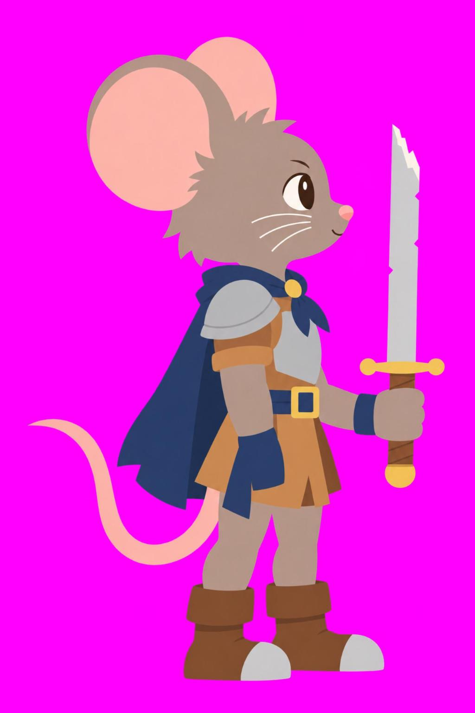

# 기사쥐 — 컨셉 기획서

| 항목 | 내용 |
|---|---|
| 작성자 | 정승운 |
| 작성일 | 2026-10-28 |
| 버전 | v0.3 |

# 목차
- 기획의도
- 원페이지 기획서
- 캐릭터
- 비쥬얼 가이드
- 액션 모션
- 이펙트 가이드
- 전투 시스템
- 제작 파이프라인

## 기획의도
- 원작 게임의 파괴 이미지를 살려 호쾌한 액션을 보여줄 수 있는 플랫포머 액션 게임을 만들자.
- 스토리 라인: 전설의 명검을 찾아 모험을 떠나는 기사쥐의 이야기
- 레퍼런스: 카타나 제로, 할로우나이트
- 원작 「찍!찍!!찍!!!」의 기사쥐 초필살기에서 보여준 시원한 베기 연출을 한 판 내내 손으로 느끼게 하는 것이 목표.
- 귀여운 겉모습과 날카로운 손맛의 대비. 보기엔 동글동글, 치면 묵직함.

## 원페이지 기획서
| 항목 | 내용 |
|---|---|
| 장르 | 2D 횡스크롤 플랫포머 액션 |
| 플랫폼 | PC (웹 프로토 → 유니티 본편) |
| 시점 | 옆모습 고정, 플레이어 가슴 높이 기준 카메라 |
| 핵심 재미 | 몸을 가로지르는 가로 베기의 손맛, 끊김 없는 이동·베기·대시 연결 |
| 주인공 | 견습 기사쥐. 부러진 롱소드 한 자루로 시작 |
| 목표 | 전설의 명검을 찾아 각 지역의 수호자를 쓰러뜨리는 여정 |
| 성장 | 장비 제작·드랍, 그물형 스킬 노드로 전투 스타일 분기 |
| 차별점 | 플랫 그림 + 코드 셰이더 명암, 칼 궤적을 따라 휘는 이펙트 |

- 한 줄 요약: 부러진 칼을 든 견습 기사쥐가 명검을 찾아가며, 베는 맛 하나로 끝까지 끌고 가는 액션 플랫포머.

## 캐릭터
### 기사쥐 (견습 기사)
- 아직 투구도 없는 견습 기사. 큰 둥근 귀가 그대로 드러나 실루엣의 중심이 됨.
- 비율은 실크송 호넷 같은 큰 머리 + 가늘고 긴 팔다리. 머리는 키의 약 38%, 다리는 약 40%.
- 얼굴은 작고 단정하게. 눈은 작은 타원에 하이라이트 한 점, 짧은 수염.
- 복장: 가죽 튜닉, 작은 강철 가슴판, 한쪽 어깨 견갑, 남색 짧은 망토와 금색 걸쇠, 남색 허리띠, 강철 앞코 부츠.
- 포인트 컬러는 남색 + 금색. 칼 궤적의 흰·금·주황이 남색 몸 위에서 가장 잘 보이는 조합.
- 무기: 2/3 지점에서 부러진 낡은 롱소드. 명검을 찾는 여정의 출발점이라는 의미.

### 허수아비 (테스트 대상)
- 모션 확인용 훈련 허수아비. 냄비 투구, 짚 몸통, 나무 방패.
- 서 있음 / 맞고 기울어짐 / 허리가 잘린 위·아래 3장.

## 비쥬얼 가이드
- 플랫한 그림체를 유지하며 명암과 이펙트는 코드를 이용해 생동감 있는 액션 연출
- 칼의 궤적끝에 이펙트 구현 가로지르는 가로 베기를 액션감 있는 모션과 함께 연출하여 타격감을 살림
- 리깅을 통해 캐릭터의 사실적 액션 표현. 리깅으로 힘든 자세(사망, 웅크림 등)가 필요할 경우 통이미지 사용 병행
- 그림은 명암 없는 완전 플랫으로 생성. 외곽선 없음, 영역마다 단색 하나.
- 명암은 코드 셰이더로 얹음.
  - 부위 실루엣으로 쿠션 모양의 높이를 만들고, 그 기울기로 법선을 계산하는 방식.
  - 빛은 화면 왼쪽 위 앞. 밝기를 2단으로 끊어 그림자 1톤 + 하이라이트 1톤의 셀 셰이딩.
  - 그림자는 남보라 곱하기, 하이라이트는 따뜻한 흰색. 원작 NKK의 1톤 그림자 + 1톤 하이라이트 느낌 계승.
  - 부위가 회전해도 빛 방향이 유지되도록 빛 각도별(24방향) 명암을 미리 구워 두고 그릴 때 고르는 구조.
- 테스트장은 남색 계열 단색. 캐릭터와 이펙트가 돋보이는 낮은 채도.

### 연출 톤: 팝아트 (젠레스 존 제로 참고)
- 귀여운 플랫 캐릭터 위에 만화·팝아트 연출을 얹어 손맛을 과장하는 방향.
- 망점 명암: 셰이더 그림자를 45도 격자 망점(벤데이 도트)으로. 그림자가 진할수록 점이 커짐.
- 잉크 판: 칼 궤적 뒤에 검은 판을 오른쪽 아래로 어긋나게 깔아 스티커처럼 떠 보이게.
- 궤적 꾸밈: 바깥 날을 따라 머리 쪽이 굵은 흰 칼선, 시안·자홍 색판을 양옆으로 벌린 RGB 분리, 칼끝에서 튀는 파편.
- 효과음 글자: 굵은 한글 효과음(챙! · 슥! · 서걱!! · 촥!). 노랑 본 글자 + 자홍 어긋난 색판 + 검은 테두리.
- 임팩트 컷: 타격 순간 화면 색 반전 1~3프레임. 막타는 반전 → 집중선 + 자홍 망점 테두리 → 슬로우 줌 순서.
- 반전·번쩍은 실제 시간 기준. 슬로우 중에도 늘어지지 않게.

## 액션 모션
### 원칙
- 모든 베기는 세로가 아닌 가로 베기. 칼이 몸을 수평으로 감아 돌며 몸을 가로지르는 궤적이 핵심.
- 옆모습에서 수평으로 도는 칼은 깊이 각(θ)으로 표현.
  - 칼 궤적은 칼날 선이 아니라 몸통 둘레의 납작한 타원(수평 원을 옆에서 본 모양) 위를 θ로 따라감. 칼날 선만 이으면 옆에서 볼 때 띠가 납작해져 안 보이기 때문.
  - 타원 아래 반(몸 앞)은 캐릭터 위, 위 반(몸 뒤)은 캐릭터 뒤에 그려 칼이 몸을 감아 도는 입체감.
  - 타원 중심은 몸보다 공격 방향으로 앞에. 궤적이 몸 앞에서 크게 펼쳐져 공격 범위가 한눈에 보이게.
- 모션은 크게. 젖힘은 몸을 뒤로 눕히며 낮게, 타격은 상체를 깊게 숙이고 크게 내딛기(1타 64px, 2타 60px, 막타 130px).
  - θ 0 = 앞, 90 = 카메라 쪽(몸 앞을 가로지름), 180 = 뒤, -90 = 몸 뒤쪽.
  - 칼 길이를 cos θ로 줄였다 늘였다 하고, 몸 앞을 지날 때 칼끝을 살짝 내려 납작한 타원 궤적을 만듦.
  - 칼이 몸 뒤쪽을 지나는 구간은 팔·칼·궤적을 몸 뒤에, 몸 앞을 지나는 구간은 몸 위에 그림.
- 예비 동작은 크게, 휘두르는 순간은 1~2프레임, 끝 자세는 잠깐 버팀. 무게감은 버티는 시간에서 나옴.
- 휘두르는 구간은 40fps로 끊어 '탁' 끊기는 맛, 칼 궤적은 원래 시간으로 매끈하게.

### 모션 목록 (1차 확정 대상)
| 모션 | 내용 | 비고 |
|---|---|---|
| 대기 | 숨쉬기, 망토·꼬리 흔들림 | |
| 달리기 | 큰 보폭 SD 달리기, 칼은 뒤로 끌림 | |
| 점프 / 낙하 / 착지 | 상승·하강 자세 보간, 착지 눌림 | 짧게 누르면 낮은 점프 |
| 대시 | 예비 동작 없이 튀어 나가 낮게, 끝에 브레이크 | 남색 잔상 + 속도선 |
| 1타 가로 베기 | 뒤로 젖혔다가 몸 앞을 가로질러 앞으로 | 굵은 궤적 |
| 2타 역가로 베기 | 몸 뒤쪽에서 앞을 지나 카메라 쪽으로 감아 올림 | 가는 궤적 |
| 3타 회전 베기 (막타) | 한 바퀴 반 회전하며 몸을 던짐 | 초승달 + 슬로우 줌 + 화면 번쩍 |
| 공중 베기 | 몸을 감는 수평 한 바퀴 | 초승달 |
| 피격 | 뒤로 젖혀지며 밀림, 흰색 번쩍 | |
| 사망 | 무릎 꿇음 → 쓰러짐 | 최종은 통그림 프레임으로 교체 예정 |

### 레퍼런스 분석
- 할로우 나이트 / 실크송: 짧고 빠른 초승달 베기, 공격 방향 고정, 타격 순간 넉백과 짧은 히트스톱.
- 카타나 제로: 화면을 가로지르는 한 획의 베기, 막타의 백색 섬광과 슬로우.
- 데드 셀: 과장된 예비 동작과 1~2프레임 타격, 끝 자세 버팀으로 무게감.
- 스컬: 예비 동작 없는 대시, 잔상과 브레이크.

## 이펙트 가이드
- 이펙트도 이미지로 생성. 흰 심 → 금색 → 주황 → 얇은 남색 테두리의 단색 띠 구성.
- 칼 궤적 리본
  - 매 프레임 칼의 손잡이·칼끝 위치를 기록하고, 리본 그림을 그 길을 따라 삼각형으로 휘어 붙임.
  - 머리는 지금 칼끝, 꼬리는 가장 오래된 자리. 칼이 멈추면 꼬리가 머리 쪽으로 감겨 들어가며 가늘어지고 사라짐.
  - 빠르게 휘두른 구간일수록 리본이 길게 늘어나 속도감이 그대로 보임.
- 초승달: 막타·공중 베기 전용. 생김(가는 흰 선) → 최대 → 찢어져 흩어짐의 3프레임.
- 타격: X자 충격 섬광, 가로 컷 섬광, 파편, 흙먼지.
- 궤적은 휘두르는 구간을 1/240초로 쪼개 그 시각의 자세로 계산. 칼이 1~2프레임 만에 몸 앞을 가로질러도 궤적이 매끈하게 이어짐.

- 화면 연출: 히트스톱(일반 0.05초, 막타 0.11초), 화면 흔들림, 막타 슬로우 + 줌, 화면 번쩍.

## 전투 시스템
- 제작과 드랍을 통한 장비 드랍
- 장비는 요구레벨과 등급이 존재(이노티아 연대기 장비 시스템 채용)
- 호쾌한 액션과 타격감 구현을 우선적으로 구현(화면 흔들림, 슬로우 줌 등)
- 레벨이 오름에 따라 그물형 스킬 노드 확장이 가능
- 확장한 스킬 노드에 따라 전투 스타일이 결정.

## 제작 파이프라인
- 1단계: 웹 프로토에서 액션 모션·이펙트 확정. 수치와 자세는 코드 표(anim.js)로 관리.
- 2단계: 웹 빌드로 공유·피드백.
- 3단계: 유니티 이식. 리그 구조(부위·관절·레이어)와 모션 표를 그대로 옮기는 방향.
- 그림 제작: Codex(한도 소진 시 ChatGPT)로 통그림 생성 → 통그림 기준 부위 시트 생성 → 통그림과 겹쳐 비교하며 리깅.
- 리깅 맞춤: 부위마다 크기·각도·위치를 통그림과 가장 잘 겹치는 값으로 자동 탐색(tools/fit_rig.py) → 관절·기본 자세 계산(tools/build_rig.py). 기본 자세로 그리면 통그림과 겹침.
- 생성 그림끼리 관절이 어긋나는 곳(팔꿈치 등)은 통그림과의 일치보다 움직일 때 붙어 있는 쪽을 우선.
